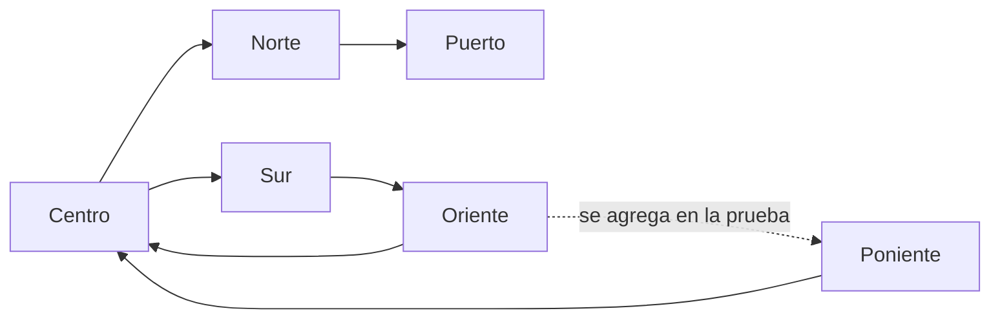
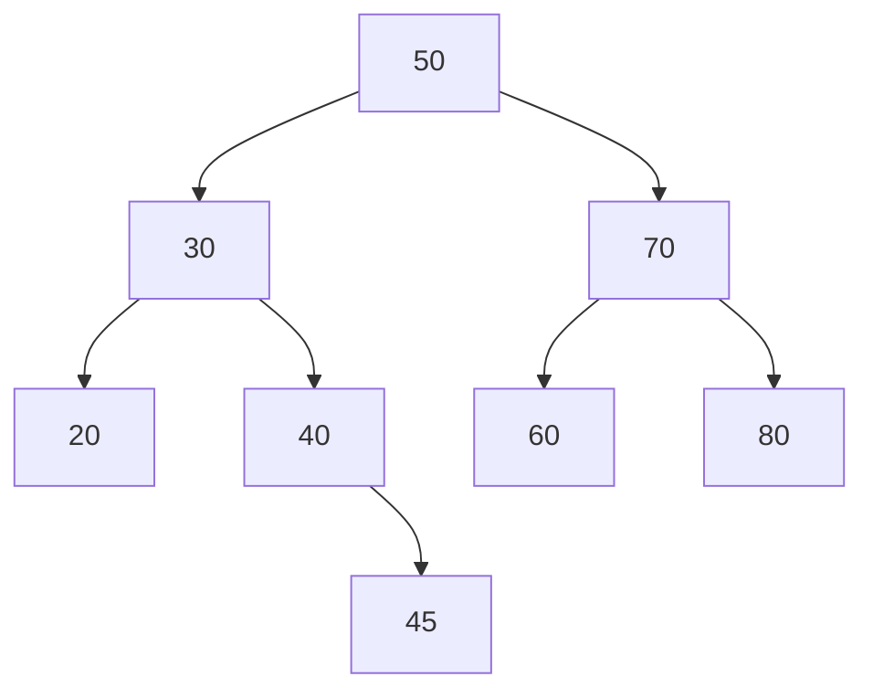

# Diseño del sistema

## Sucursales

| Índice | Sucursal |
|---|---|
| 0 | Centro |
| 1 | Norte |
| 2 | Sur |
| 3 | Oriente |
| 4 | Poniente |
| 5 | Puerto |

## Grafo dirigido (conexiones iniciales)



```
   Poniente ──► Centro ──► Norte ──► Puerto
                 ▲  │
                 │  ▼
             Oriente ◄── Sur
```

- Hay un ciclo: Centro → Sur → Oriente → Centro.
- Al inicio ninguna sucursal llega a **Poniente**, así que los paquetes con destino Poniente no tienen ruta.
- En la prueba se agrega **Oriente → Poniente** (línea punteada) y con eso ya existe la ruta Centro → Sur → Oriente → Poniente.

## Matriz de adyacencia inicial

Fila = origen, columna = destino.

| | Centro | Norte | Sur | Oriente | Poniente | Puerto | **Salida** |
|---|:-:|:-:|:-:|:-:|:-:|:-:|:-:|
| **Centro**   | 0 | 1 | 1 | 0 | 0 | 0 | 2 |
| **Norte**    | 0 | 0 | 0 | 0 | 0 | 1 | 1 |
| **Sur**      | 0 | 0 | 0 | 1 | 0 | 0 | 1 |
| **Oriente**  | 1 | 0 | 0 | 0 | 0 | 0 | 1 |
| **Poniente** | 1 | 0 | 0 | 0 | 0 | 0 | 1 |
| **Puerto**   | 0 | 0 | 0 | 0 | 0 | 0 | 0 |
| **Entrada**  | 2 | 1 | 1 | 1 | 0 | 1 | |

Grado de salida = suma de la fila. Grado de entrada = suma de la columna.

Después de agregar Oriente → Poniente: Oriente queda con salida 2 y Poniente con entrada 1.

## Paquetes de prueba

| Folio | Descripción | Peso (kg) | Origen | Destino |
|---|---|---|---|---|
| 50 | Laptop | 2.50 | Centro | Puerto |
| 30 | Libros | 4.00 | Centro | Norte |
| 70 | Refacciones | 7.25 | Centro | Poniente |
| 20 | Ropa | 1.20 | Sur | Centro |
| 40 | Telefono | 2.50 | Poniente | Norte |
| 60 | Juguetes | 3.10 | Norte | Puerto |
| 80 | Microondas | 12.00 | Oriente | Sur |
| 45 | Documentos | 0.80 | Puerto | Centro |

Se insertan en ese orden en el ABB.

## ABB construido



```
            50
          /    \
        30      70
       /  \    /  \
     20   40  60   80
            \
             45
```

## Recorridos esperados

| Recorrido | Resultado |
|---|---|
| Preorden  | 50 30 20 40 45 70 60 80 |
| Inorden   | 20 30 40 45 50 60 70 80 |
| Postorden | 20 45 40 30 60 80 70 50 |

## Reporte por peso (Radix Sort)

El arreglo se copia del ABB en inorden, así que empieza ordenado por folio. Cada pasada de radix es estable, por eso cuando dos paquetes pesan lo mismo (40 y 50, 2.50 kg) queda primero el de menor folio.

El peso se pasa a gramos (2.50 kg → 2500) para ordenar por dígitos.

Resultado esperado: **45, 20, 40, 50, 60, 30, 70, 80**
